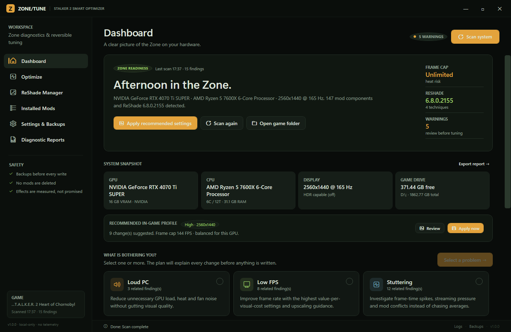
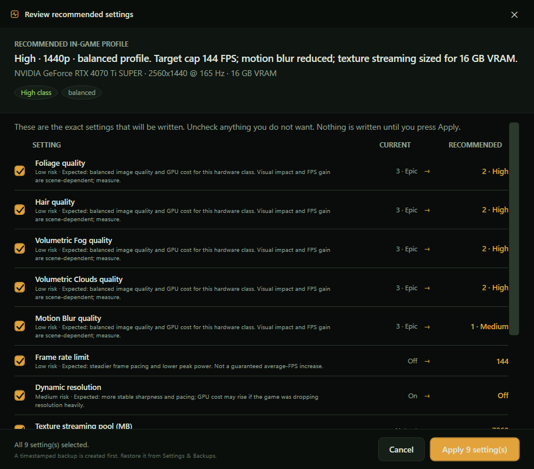
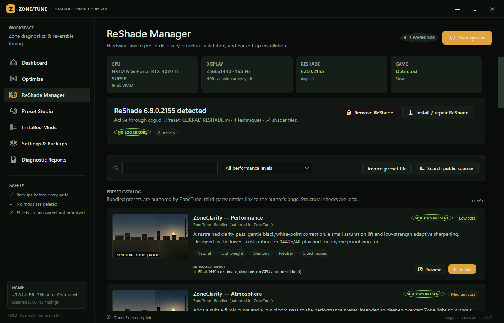
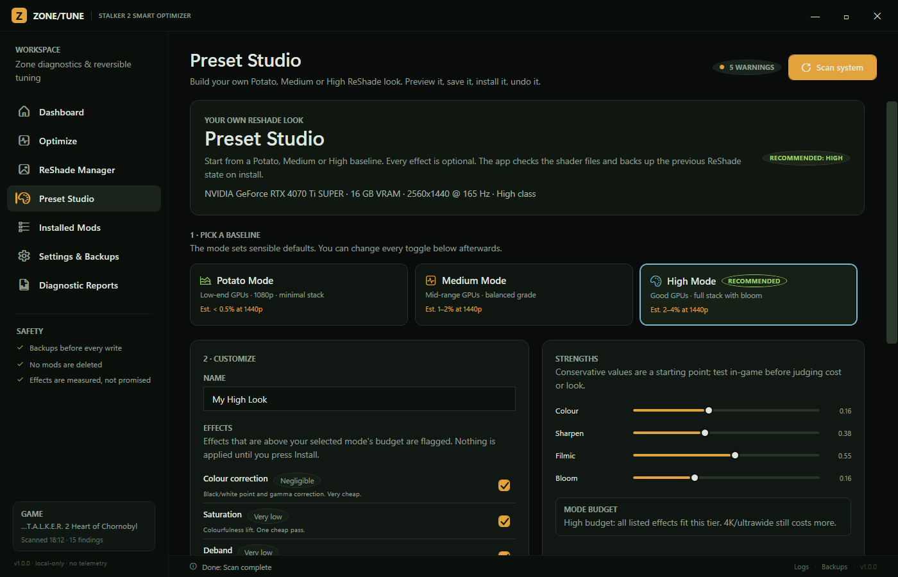

# ZoneTune — STALKER 2 Smart Optimizer

[GitHub repository](https://github.com/Hurricane190/S.T.A.L.K.E.R.-2-Smart-Optimizer-ReShade-Installer) · [Latest release](https://github.com/Hurricane190/S.T.A.L.K.E.R.-2-Smart-Optimizer-ReShade-Installer/releases/latest)

A local-only Windows desktop tool for **S.T.A.L.K.E.R. 2: Heart of Chornobyl** that detects the PC and the game, diagnoses performance problems, generates reversible configuration packages, and manages ReShade presets with backups.

Automatically scans your hardware and recommends the right settings. Includes a Preset Studio with ReShade install/removal, a ready-made preset catalog, and Potato / Medium / High custom modes. A separate Mod Analyzer inventories installed mods with static performance evidence and a reversible quarantine.

> **Honesty first:** ZoneTune does not promise FPS gains. Every effect is labelled as an estimate until you capture a before/after measurement with PresentMon. “Structurally verified” means the preset parsed and its shader files exist — **not** that it was visually tested.



## What it does

| Area | Capability |
|---|---|
| **Dashboard** | Hardware/game/ReShade overview, selectable problem cards, top evidence-backed findings, one-click recommended profile |
| **Optimize** | Builds a plan for Loud PC / Low FPS / Stuttering, shows current → proposed values and evidence, applies only checked changes after backup, exports a ZIP package |
| **Recommended in-game settings** | Derives a balanced profile from GPU tier, VRAM and resolution, previews all changes, and applies them to `GameUserSettings.ini` with one **Apply** button |
| **Preset Studio + ReShade** | Detects GPU/resolution/HDR/ReShade state, installs/repairs/removes ReShade, lists bundled + third-party + public GitHub presets, validates shader presence, previews and compares, and builds custom **Potato / Medium / High** presets with save/export/undo |
| **Installed Mods** | Inventories pak mods, UE4SS Lua mods, ASI plugins, config overrides, Vortex/load-order metadata and conflict logs; enable/disable is a reversible move |
| **Mod Performance Analyzer** | Inspects pak/IoStore indexes, Lua patterns, assets, native files and overlaps; labels LOW/MEDIUM/HIGH/UNKNOWN with confirmed facts vs hypotheses; verified quarantine/restore; manual PresentMon before/after comparison |
| **Settings & Backups** | Manual game path, backup root, retention, network policy, log access, restore/delete change sets |
| **Diagnostic Reports** | HTML/Markdown/JSON reports, PresentMon CSV import, before/after comparison, frame-time statistics |

## Safety model

- **Never deletes mods.** Disable moves files to `~mods.disabled`; enable moves them back. The Mod Analyzer's quarantine copies and hash-verifies every file before removing the original from the load path, records a manifest, and restores on request.
- **Backups before every write.** Each apply/install creates a timestamped change set with the original bytes and SHA-256 hashes. Restores also snapshot the current state, so a restore is itself reversible.
- **Never overwrites without a backup.** Presets, `ReShade.ini`, proxy DLLs, `GameUserSettings.ini` and `Engine.ini` are recorded first.
- **Game must be closed** before applying/installing (the game rewrites `GameUserSettings.ini` on exit and locks DLLs).
- **No telemetry, no cloud sync, no account.** Data stays in `%LOCALAPPDATA%\ZoneTune`.
- **Network is allowlisted.** HTTPS only; hosts limited to `reshade.me` and GitHub. The ReShade setup is checked against the published SHA-256 **and** the official certificate thumbprint before execution.
- **Third-party presets are linked, not repackaged.** Nexus Mods presets open the author’s page; automatic install is only offered for ZoneTune-authored presets, local imports, or GitHub repositories with an explicit permissive license.

## How to undo (settings, presets, ReShade, mods)

Every write creates a timestamped change set before touching a file. To switch back:

- **Dashboard → Undo last change** — restores the most recent non-restored change set (settings apply or ReShade install).
- **Settings & Backups → Restore latest change** — same action, with the full change-set list below it.
- **Settings & Backups → Restore** on a specific row — restores that exact point.
- **Preset Studio → Uninstall & restore** — rolls back the last preset/ReShade install from this app.
- **Preset Studio → Remove ReShade** — runs the official uninstaller (backup kept; you can restore the module later).
- **Preset Studio → Undo last preset install** — restores the preset and `ReShade.ini` that were active before the Studio install.
- **Mod Analyzer → Restore quarantined mods** — returns hash-verified files to their original paths; collisions are refused, never overwritten.

A restore first snapshots the current state, so an undo is itself undoable. The game must be closed. Restored config files are byte-identical to the originals (verified by SHA-256).

## Recommended in-game settings (scan → offer → Apply)

After a scan, ZoneTune derives a profile from:

- GPU class and VRAM (e.g. RTX 4070 Ti SUPER, 16 GB)
- native resolution and refresh (e.g. 2560×1440 @ 165 Hz)
- current scalability groups, VSync, dynamic resolution, frame cap
- current texture/streaming state

It proposes values for all `sg.*` scalability groups, a frame cap below refresh, VSync/dynamic-resolution changes, and a VRAM-aware streaming pool. **Apply recommended** first opens a review sheet listing every current → proposed value with a checkbox per setting; only confirmed settings are written to:

```
%LOCALAPPDATA%\Stalker2\Saved\Config\Windows\GameUserSettings.ini
%LOCALAPPDATA%\Stalker2\Saved\Config\Windows\Engine.ini
```

before writing, it creates a change set; after writing, it re-reads the files and validates every value. If validation fails it rolls back automatically. The upscaler (DLSS/FSR/XeSS) is presented as a manual in-game recommendation because STALKER 2’s menu selection is not safely writable through config.

The profile is a **balanced starting point**, not a measured guarantee. Lower the cap or individual groups to taste; use Settings & Backups to restore.



## Preset Studio & ReShade details

- **Detection:** active proxy DLL, ReShade version from file/log, add-on build, preset path, techniques, missing shaders, duplicate shader names, effect errors/warnings, other proxy DLLs, HDR conflict.
- **Hardware:** GPU, VRAM, primary resolution/refresh, HDR support/enabled, bits per colour channel (Windows DisplayConfig).
- **Catalog filters:** *All performance levels*, **High performance · low detail**, **Balanced**, **Ultra detail · high cost**, Bundled, Author pages, Direct download.
- **Presets:** three ZoneTune-authored presets (Performance / Atmosphere / Cinematic), ten curated Nexus Mods entries with real source links, live GitHub search (permissively licensed repos only), and local import.
- **Preview:** a synthetic, clearly labelled colour preview (not a game screenshot), before/after, comparison against another preset, technique/shader validation, requirements, license, cost estimate.
- **Install / repair:** official signed ReShade setup (headless DXGI), only the required `.fx`/`.fxh` files from the official crosire/reshade-shaders repo, preset written next to `Stalker2-Win64-Shipping.exe`, `ReShade.ini` updated, then structural validation. The ReShade status card is at the top of Preset Studio.
- **Removal:** official headless uninstaller, with proxy/config/preset backup. **Uninstall & restore** restores the exact prior state, including files created by ZoneTune.
- **Catalog:** the same bundled, third-party author-page, local import and public GitHub search options now live in section 4 of Preset Studio.



### Preset Studio (build your own)

**Preset Studio** creates a preset from three hardware-aware baselines:

| Mode | Intended for | Stack | Estimate |
|---|---|---|---|
| **Potato** | Low-end GPUs / 1080p | Levels, saturation, deband, light sharpen | < 0.5% at 1440p |
| **Medium** | Mid-range GPUs / 1440p | Adds filmic curve | 1–2% at 1440p |
| **High** | Good GPUs with headroom | Adds bloom | 2–4% at 1440p |

Every effect can be toggled, and colour/sharpen/filmic/bloom strengths are adjustable. The app recommends a mode from GPU tier, VRAM and resolution; effects above the selected budget are flagged. Preview is a synthetic before/after; save/export writes a normal `.ini`, install uses the same signed ReShade + official shader pipeline, and **Undo last preset install** restores the previous preset and `ReShade.ini`.



### Compatibility wording

| Badge | Meaning |
|---|---|
| **Shaders present** | The preset parsed and every referenced shader is present on this PC. Syntax, not visual result. |
| **Shaders missing** | At least one referenced shader file is absent; the preset may load partially. |
| **Unverified source** | Author-page preset; content was not downloaded or tested. |
| **Estimated** | Cost/compatibility inferred from author data or hardware class; not measured here. |

## Mod Performance Analyzer

**Mod Analyzer** reads installed mods without executing them:

- legacy pak indexes and IoStore `.utoc` directory indexes (never the huge `.ucas` payload)
- Lua hooks/loops/actor queries/spawn calls, asset categories, config values, native files and cross-mod asset overlaps

Each mod gets **LOW / MEDIUM / HIGH / UNKNOWN**, a confidence label, the inspected evidence and explicit limitations. A HIGH label is a strong static hypothesis, not a measured FPS drop. File size alone is never used as a performance risk.

If you know a MEDIUM/HIGH-risk mod is intentional and want to keep it, press **Ignore** on its row. The warning disappears from the summary and flagged filters, the evidence stays available under **Details**, and **Unignore** restores it. Ignore decisions survive rescans and app restarts (`%LOCALAPPDATA%\ZoneTune\mod-ignores.json`).

Quarantine is reversible and verified: copy → SHA-256 check → remove from load path, with a JSON manifest and restore. Vortex-managed mods, config overrides and merger output are refused with an explanation; UE4SS folders are moved whole without editing `mods.json`/`mods.txt`.

The comparison section accepts two PresentMon CSVs and reports measured before/after metrics, but applies them to the tested condition, never to an individual mod without a controlled test. Full details: [docs/MOD_ANALYZER.md](docs/MOD_ANALYZER.md).

## Measurements (required for claims)

1. Install [PresentMon](https://github.com/GameTechDev/PresentMon) or CapFrameX.
2. Capture the same save/route for 60+ seconds after shader warm-up.
3. Change one thing (config, preset, upscaler).
4. Capture again with identical settings.
5. Import both CSVs in **Diagnostic Reports**.

ZoneTune reports average FPS, 1% / 0.1% lows, median/p95/p99 frame times, a stutter index (`p99/median − 1`) and a frame-time graph. It never adds a “verified FPS gain” badge.

## Requirements

- Windows 10/11 x64
- STALKER 2 (Steam or Xbox/MSIX layout; manual folder selection supported)
- Self-contained build: no .NET installation required
- Optional: network access for ReShade/shaders/public search; ReShade 5.0+ for preset features

## Quick start

1. Run `ZoneTune.exe`.
2. It scans automatically. If detection fails, open **Settings & Backups → Game folder → Browse**.
3. Use **Apply recommended settings** on the Dashboard, or open **Optimize** to select specific problems and review a detailed plan.
4. Close the game before applying. The app refuses to write while `Stalker2-Win64-Shipping.exe` is running.
5. For post-processing, open **Preset Studio**, install/repair ReShade if needed, preview a catalog preset, then install.
6. To investigate a suspected mod, open **Mod Analyzer → Scan Mods**, review the evidence, then quarantine selected mods or import before/after CSVs.
6. If anything feels wrong, restore the relevant change set from **Settings & Backups**.

## Install / build

See [INSTALL.md](INSTALL.md) for users and [BUILD.md](BUILD.md) for developers.

Maintenance, update, release and recovery procedures: [MAINTENANCE.md](MAINTENANCE.md).

```powershell
# Release build
.\build.ps1
# -> dist\ZoneTune.exe, dist\zonetune-cli.exe and documentation
```

## Test evidence

The shipped build was developed and tested on:

- AMD Ryzen 5 7600X, 32 GB RAM, NVIDIA RTX 4070 Ti SUPER 16 GB, Windows 11 26H2, 2560×1440 @ 165 Hz
- Real STALKER 2 Steam install with 66 mod components (after the nested-pak inventory fix), ReShade 6.8, UE4SS, ASI plugins and Vortex metadata
- 64/64 core self-tests (`zonetune-cli --selftest`), including fixture-based mod analyzer and quarantine tests
- Sandboxed ReShade end-to-end: download → hash/signature verification → headless install → shader extraction → preset install → structural validation → official uninstall → restore → rollback (PASS)
- UI smoke test: all seven tabs load (Dashboard, Optimize, Preset Studio, Installed Mods, Mod Analyzer, Settings, Reports), preview window renders, no unhandled dispatcher exceptions

Self-test coverage includes: INI round-trip, hardware/game/config/mod/ReShade detection, preset parsing/validation, plan generation, recommended-profile apply + rollback in a sandbox, reversible mod disable/enable, Preset Studio mode/fallback generation, package structure and merged values, backup hash-exact restore, PresentMon statistics, report export, and official shader/ReShade verification. A separate real apply test writes the recommended profile to the live config, validates every value, restores it, and confirms the original files are byte-identical.

Detailed evidence: [docs/TEST_RESULTS.md](docs/TEST_RESULTS.md).

## Known limitations

- **No visual validation.** ReShade presets are not launched in-game by the tool; “verified” is structural only.
- **Nexus Mods automation is intentionally absent.** Their API/distribution terms require author control; the app opens author pages and accepts local imports.
- **In-game upscaler selector** is not written by config; the profile recommends it instead.
- **HDR + ReShade** is flagged, not automatically changed.
- **Effects are estimates.** GPU tier classification is heuristic; frame-time gains depend on scene, driver and CPU.
- **Mod analysis is static.** Encrypted/unreadable archives and native plugins are reported as UNKNOWN. A HIGH risk label is a strong static hypothesis, not a measured FPS drop. Per-mod attribution requires a controlled before/after capture.
- **Xbox/MSIX paths** are supported by validation/manual selection, but the primary tested environment was Steam.
- **No vendor power-limit automation.** Undervolt/power-limit advice is manual and GPU-specific.
- **Public GitHub search** only sees repositories with a permissive license and may be rate-limited.

## Privacy

ZoneTune reads local hardware, game configs, mod names and logs. Reports contain local paths and hardware details; review them before sharing. No data is uploaded. See [ERROR_LOGGING.md](ERROR_LOGGING.md).

## License / credits

ZoneTune source is MIT licensed. ZoneTune-authored presets are CC0-1.0. ReShade is © crosire and contributors (BSD-3-Clause); shader files are downloaded from the official repository and retain their individual licenses. STALKER 2 and GSC Game World are trademarks of their owners. This project is not affiliated with GSC Game World, crosire, Nexus Mods, or Intel.

See [THIRD_PARTY_NOTICES.md](THIRD_PARTY_NOTICES.md).
